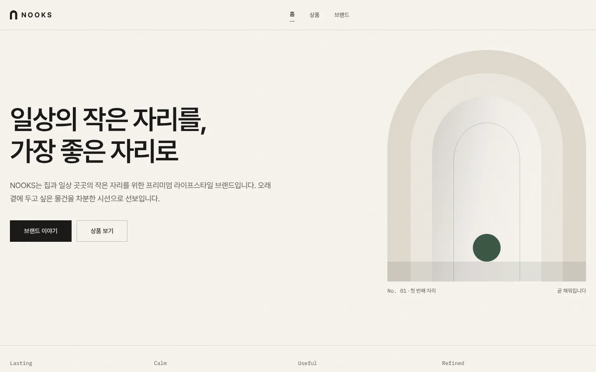

# NOOKS — 프리미엄 라이프스타일 브랜드 웹사이트

[](https://github.com/startup-valueup/nooks)

[](https://astro.build/)
[](https://tailwindcss.com/)
[](https://www.typescriptlang.org/)
[](./LICENSE)

**미리보기:** 운영 주소가 정해지기 전까지는 저장소 페이지(https://github.com/startup-valueup/nooks)로 연결됩니다. 배포 후 이 링크를 실제 주소로 바꿔 주세요.

NOOKS는 집과 일상 곳곳의 작은 자리를 위한 프리미엄 라이프스타일 브랜드의 쇼핑몰 사이트입니다. 특정 상품군에 묶이지 않고, 앞으로 다양한 생활용품을 하나씩 더해 갈 수 있도록 만들었습니다. [Atelier Kō Astro 테마](https://github.com/andreialba)(MIT, Andrei Alba)를 기반으로, 헤어라인과 직각 모서리의 건축적인 레이아웃·절제된 모션·정적 출력이라는 장점은 그대로 살리고 한국어 중심의 디자인으로 다시 다듬었습니다. 따뜻한 린넨 톤의 바탕, 깊은 모스 그린 포인트, 브랜드의 유일한 곡선인 아치(벽면의 오목한 자리, nook)가 NOOKS의 시각 언어입니다.

> 현재 판매 상품은 확정되지 않았습니다. 사이트에는 실제 상품명·가격·연락처·사업자 정보가 들어 있지 않으며, 값을 채우기 전까지는 해당 영역이 표시되지 않습니다.

## 주요 기능

- 한국어 중심 UI — Pretendard Variable 동적 서브셋, `word-break: keep-all`, 한글에 맞춘 행간·자간, `lang="ko"`·`og:locale`
- 브랜드 아이덴티티 — 아치 로고 마크, 파비콘(다크 모드 대응), 소셜 공유 카드, 디자인 토큰 기반 팔레트
- 사진 없이도 완성되는 메인페이지 — 히어로 아치 일러스트, 브랜드 원칙, 생활 공간 소개, 선별 기준, 브랜드 선언 밴드
- 상품이 등록되면 자동으로 나타나는 상품 섹션 — 메인 추천 그리드, 단독 추천, 상품 목록(카테고리·소재 필터, 가격 정렬, 결과 수, 빈 상태)
- 정적 상품 상세 페이지 — 썸네일 전환 갤러리, 사양 표, 관련 상품, Product·BreadcrumbList JSON-LD
- 마크다운 한 파일이 상품 한 개 — Zod 스키마 검증, `draft` 상품은 개발 서버에서만 표시
- 설정 한 곳에서 관리 — 브랜드명, 내비게이션, 푸터, 연락처, 사업자 정보, SNS, 뉴스레터, 가격 표시(KRW), 추천 상품
- 설정하지 않은 값은 표시하지 않는 안전한 기본값 — 빈 이메일·SNS·사업자 항목·뉴스레터 폼은 렌더링되지 않음
- 스크롤 모션은 IntersectionObserver 하나로 구현, 모션 감소 설정과 JavaScript 비활성화 환경에서도 모든 페이지가 완전하게 표시됨
- 접근성 — 본문 바로가기, 랜드마크, 페이지당 `h1` 하나, 라벨이 있는 모든 입력, 포커스 트랩이 있는 모바일 메뉴, 보이는 포커스 링
- SEO — 정규 URL(트레일링 슬래시 통일), Open Graph·Twitter 카드, Organization·WebSite·Product JSON-LD, 사이트맵, `robots.txt`
- 완전한 정적 출력, 폰트 포함 외부 도메인 요청 없음

## 기술 스택

- Astro 7
- Tailwind CSS 4 (Vite 플러그인)
- TypeScript (strict)
- Astro 콘텐츠 컬렉션
- `@astrojs/sitemap`
- Sharp (이미지 처리)

## 요구 사항

- Node.js `22.12.0` 이상
- npm

## 시작하기

```bash
npm install
npm run dev
```

타입 검사와 프로덕션 빌드:

```bash
npm run check
npm run build
```

빌드 결과 미리보기:

```bash
npm run preview
```

## 배포

빌드 결과는 순수 정적 `dist/` 폴더이므로 어떤 정적 호스팅에서도 동작합니다. 정규 URL, Open Graph 이미지 URL, 사이트맵, `robots.txt`, JSON-LD는 모두 아래 도메인 값에서 만들어지므로 운영 빌드 전에 반드시 지정하세요.

```bash
SITE=https://운영-도메인 npm run build
```

`SITE`를 지정하지 않으면 예약 도메인인 `https://nooks.example`이 쓰여 실수로 운영 사이트로 오인되지 않습니다. 카페24 일반 웹호스팅용 SFTP 배포 절차는 3단계에서 추가됩니다.

## 사용자화

가장 먼저 [src/config/site.ts](./src/config/site.ts)를 확인하세요. 브랜드명, 태그라인, 메타데이터, 연락처, 사업자 정보, 내비게이션, 푸터, 가격 표시, 추천 상품이 모두 이 파일에 있습니다. 디자인 토큰, 타이포그래피, 컴포넌트 클래스, 모션, 상품 프런트매터는 [CUSTOMIZATION.md](./CUSTOMIZATION.md)에, 브랜드 기준은 [docs/brand/BRAND_GUIDE.md](./docs/brand/BRAND_GUIDE.md)에 정리되어 있습니다.

## 콘텐츠

상품은 [src/content/products](./src/content/products)에 파일 하나당 상품 하나로 등록합니다. 파일명이 URL이 되므로 `my-item.md`는 `/products/my-item/`로 제공됩니다. 프런트매터는 [src/content.config.ts](./src/content.config.ts)의 스키마로 검증되고, 카테고리와 소재는 파일 내용에서 자동으로 집계됩니다. 이미지는 최적화를 위해 [src/assets](./src/assets)에 두세요.

[`_sample.md`](./src/content/products/_sample.md)는 화면 확인용 샘플로 `draft: true`이며 `npm run dev`에서만 보입니다. 프로덕션 빌드에는 포함되지 않습니다.

## 페이지

| 경로                | 페이지                                                |
| ------------------- | ----------------------------------------------------- |
| `/`                 | 메인페이지                                            |
| `/catalog/`         | 상품 목록 (등록된 상품이 없으면 준비 중 안내)         |
| `/products/[slug]/` | 상품 상세, 마크다운 파일마다 생성                     |
| `/about/`           | 브랜드 이야기                                         |
| `/cart/`            | 장바구니 (비활성화 상태에서는 안내만 표시, `noindex`) |
| `/404`              | 페이지를 찾을 수 없음 (`noindex`)                     |

## 타이포그래피

[Pretendard Variable](https://github.com/orioncactus/pretendard)(SIL OFL 1.1)을 동적 서브셋(92개 조각)으로 자체 호스팅합니다. 브라우저는 화면에 쓰인 글자가 속한 조각만 내려받고, 라틴·숫자와 가장 자주 쓰는 한글이 든 두 조각만 미리 불러옵니다. 숫자·가격·참조 번호에는 [IBM Plex Mono](https://fonts.google.com/specimen/IBM+Plex+Mono) 400(라틴)을 씁니다. 폰트 라이선스는 [src/assets/fonts/pretendard/LICENSE.txt](./src/assets/fonts/pretendard/LICENSE.txt)에 있습니다.

## 라이선스

MIT. 원본 Atelier Kō 테마의 저작권 고지(Andrei Alba)를 유지합니다. 전체 조항은 [LICENSE](./LICENSE)를 확인하세요.
